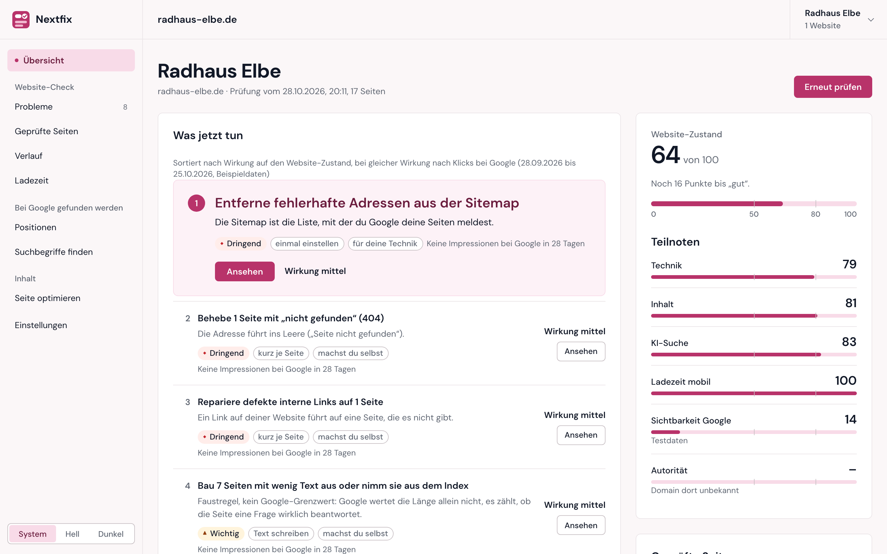
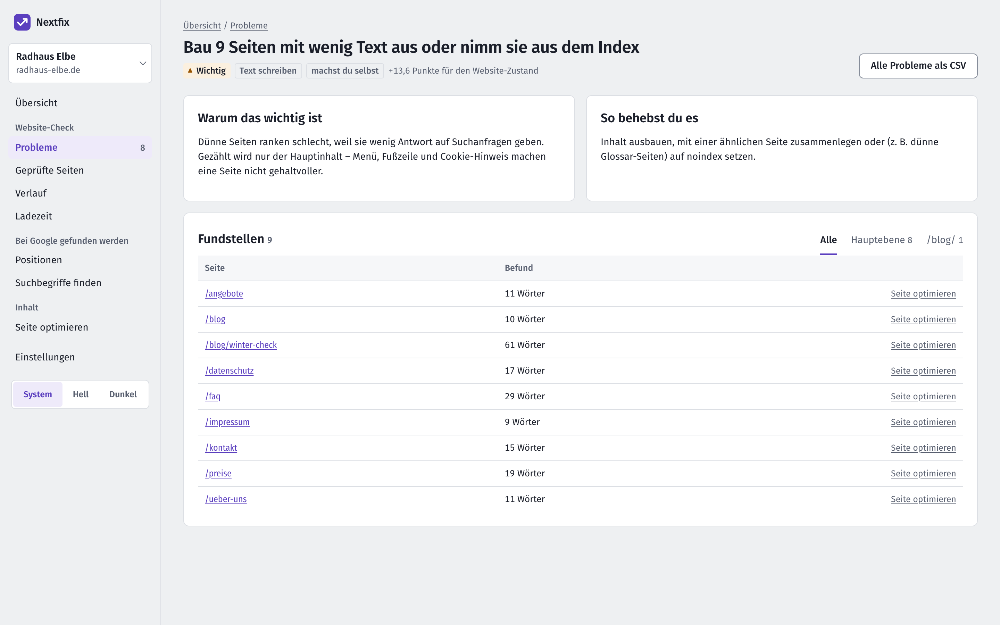
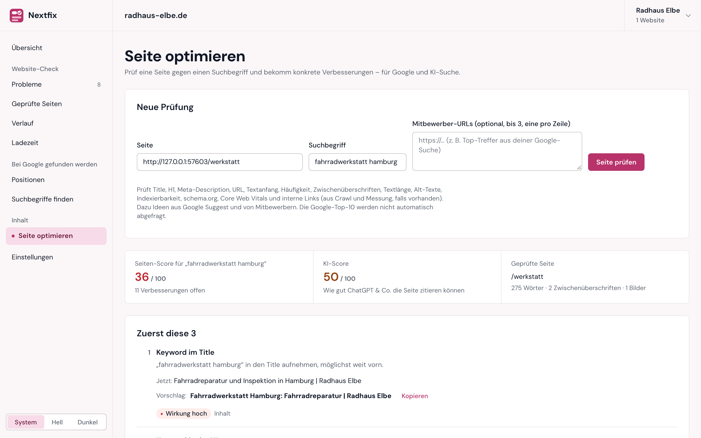
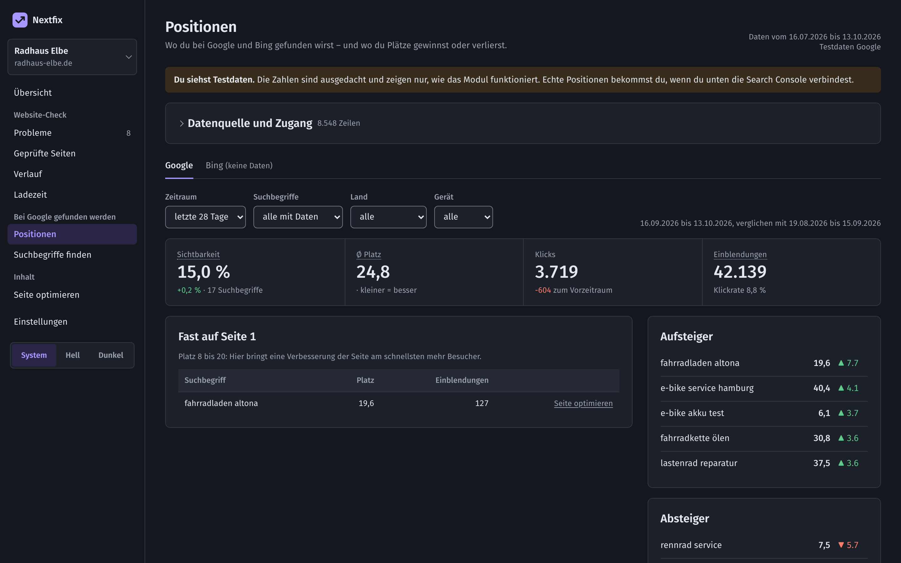
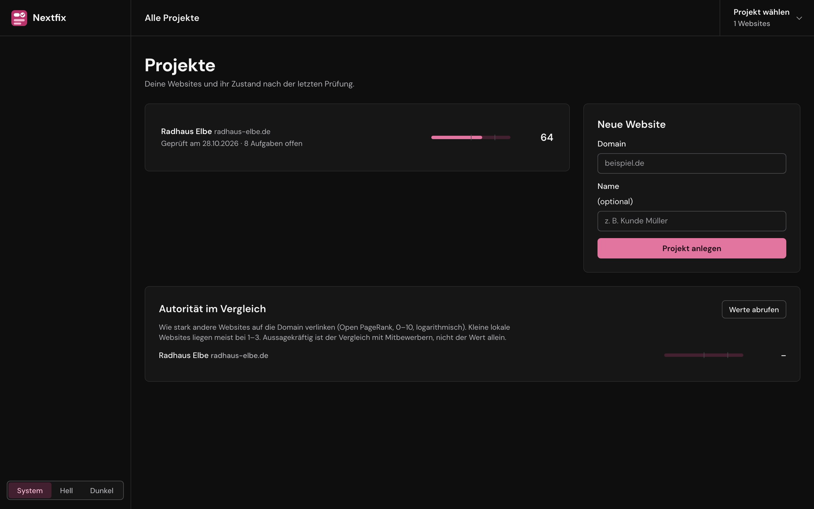

# Nextfix

[](LICENSE)


**An SEO tool that tells you what to fix next.** Runs locally, costs nothing, and can be fully operated by Claude
via MCP.

Large SEO suites show hundreds of numbers (errors, warnings, notices) and leave it to you to decide where to start.
Nextfix audits a website just as thoroughly and turns the result into a short list: **what to do first, why, how,
and how much it will help.**

<picture>
  <source media="(prefers-color-scheme: dark)" srcset="docs/screenshots/uebersicht-dunkel.png">
  
</picture>

<sub>All screenshots show the fictional demo website “Radhaus Elbe” (`scripts/demo_website.py`). The user interface
is in German.</sub>

## Features

| Module | Question it answers |
|---|---|
| **Site audit** | What is broken, and what comes first? Crawler (links, sitemap or both, robots.txt, optional JavaScript rendering), 106 checks in 8 areas, site health 0–100, tasks ranked by impact (high / medium / low), “intentional” flag to hide deliberate cases, history between audits, CSV and PDF report. |
| **Page speed** | Is the site fast enough? Core Web Vitals (LCP, CLS, TBT) measured in the lab with real Chromium, mobile and desktop, scored with the Lighthouse formula and checked against PageSpeed Insights. Poor values count towards site health; optionally measured automatically after every crawl. |
| **Rankings** | Where am I found, where am I losing ground? Data from Google Search Console and Bing Webmaster Tools: visibility, winners and losers, “almost on page 1”, keyword cannibalization, daily import. |
| **Authority** | How strong is my domain compared to competitors? Open PageRank value (0–10) for every project and any competitor domain, cached for 30 days, free API key. |
| **Keyword research** | What is worth writing about? Ideas from Google Autocomplete and your own Search Console data, clustering, search intent, questions, search volume via Bing, content gap against competitors. |
| **Page optimization** | What should I change on this page? Page score for a target keyword (20 rules) plus an AI score (12 rules for ChatGPT, Perplexity and similar), “top 3 first” with a concrete, copy-ready suggestion. |

On top of that, checks for **AI search (GEO)**: llms.txt, blocked AI crawlers, citations, FAQ markup, author and
date, organization markup, based on the GEO study (Princeton, KDD 2024).

| | |
|---|---|
|  |  |
| **Issue detail**: why it matters, how to fix it, affected pages grouped by template | **Page optimization**: page and AI score, the three most effective changes with a suggestion |
|  |  |
| **Rankings**: key metrics and “almost on page 1” opportunities (test data shown) | **Projects**: all websites with their health |

## What makes it different

- **Tasks, not a wall of numbers.** Every issue becomes one sentence with an action, the effort involved
  (“configure once”, “write text”), who does it (yourself in the CMS, or your developer/host) and its impact
  (high / medium / low). No fake precision like “+4.2 points”: nobody can predict what a fix does to rankings.
- **An honest health score.** The formula does not dilute problems across checks that never fire, and thin content
  on many pages weighs as much as an error (`app/core/score.py`).
- **Plain language.** Urgent / Important / Polish instead of Error / Warning / Notice, technical terms explained.
- **Zero cost.** No paid APIs and no scraping of Google results (terms of service). Rankings come only from Search
  Console and Bing, the sources website owners already have access to.
- **Three interfaces, one core.** Web UI, REST API (`/docs`) and an MCP server for Claude share the same functions.
- **Light and dark mode**, mobile-friendly, works offline (font and HTMX are bundled).

## Quick start

Requires Python 3.12 or newer.

```bash
python3 -m venv .venv
.venv/bin/pip install -r requirements.txt
.venv/bin/playwright install chromium          # for page speed and PDF reports
.venv/bin/uvicorn app.web:app --reload         # http://localhost:8000
```

**On a Mac without the terminal:** double-click `Nextfix starten.command` in the project folder. It starts Nextfix
and opens http://localhost:8000 in your browser; the first start sets everything up (a few minutes, only once).
Close the window to stop Nextfix. If macOS blocks the file (e.g. after downloading the ZIP), right-click it, choose
“Open” and confirm once.

Then add a domain and click “Website prüfen” (audit website). No website of your own? Start the demo site:

```bash
.venv/bin/python -m scripts.demo_website 8798  # demo website “Radhaus Elbe” at http://127.0.0.1:8798/
```

Create a project with the start URL `http://127.0.0.1:8798/`. Rankings can be tried out without access using test
data.

### With Claude (MCP)

```bash
.venv/bin/python -m app.mcp_server             # MCP server (stdio)
```

For Claude Code, copy `.mcp.json.example` to `.mcp.json` and set your project path. 50 tools, e.g.
`crawl_starten`, `issues_liste`, `onpage_pruefen`, `positionen_uebersicht`, `keyword_recherche_starten`,
`vitals_messen`, `pdf_bericht`.

### Google Search Console, Bing and Open PageRank

Setup guides (German): [`docs/anleitung-gsc.md`](docs/anleitung-gsc.md),
[`docs/anleitung-bing.md`](docs/anleitung-bing.md). For domain authority, get a free key at
[openpagerank.keywordseverywhere.com](https://openpagerank.keywordseverywhere.com/dashboard) and save it as
`~/.config/seo-tool/openpagerank-api-key.txt`. Credentials live outside the project in `~/.config/seo-tool/`
and never end up in Git.

## Development

```bash
.venv/bin/python -m pytest -q                  # tests (no network needed)
.venv/bin/python -m scripts.screenshots        # regenerate screenshots (separate demo database)
```

| Folder | Contents |
|---|---|
| `app/core/` | Services, all business logic |
| `app/checks/` | Check catalog: one `@check` per check, one module per area |
| `app/crawler/` | Crawler, parser, lab measurement of page speed |
| `app/onpage/` | Page check against a target keyword, AI score |
| `app/gsc/`, `app/keywords/` | Search Console, Bing, Google Autocomplete |
| `app/web/` | Web UI (Jinja + HTMX), design system in `static/app.css` |
| `app/api/`, `app/mcp_server/` | REST API and MCP tools |
| `app/berichte/` | PDF report (Playwright) |
| `scripts/` | Demo website and screenshot script |
| `docs/` | Architecture, guides, UI concept (`docs/ui/`) |

Convention: a new feature starts in `app/core/`, then gets wired into the API, the UI **and** MCP, plus a test.
Data is stored in `data/seo.db` (SQLite, not in Git); set a different path with `SEO_DB`. Code and UI are written
in German.

## Limitations

- No individual backlinks and no competitor rankings; both would require paid databases. Domain authority (one value
  per domain) comes from Open PageRank.
- JavaScript rendering is optional and slower (Chromium per page); without it, content rendered only by JS is not seen.
- Page speed is a lab measurement, not field data from real users (CrUX).

## License

[MIT](LICENSE). Font: [Fira Sans](https://github.com/mozilla/Fira) (SIL Open Font License,
`app/web/static/fonts/OFL.txt`). HTMX 2.0.4 (BSD-2-Clause).
